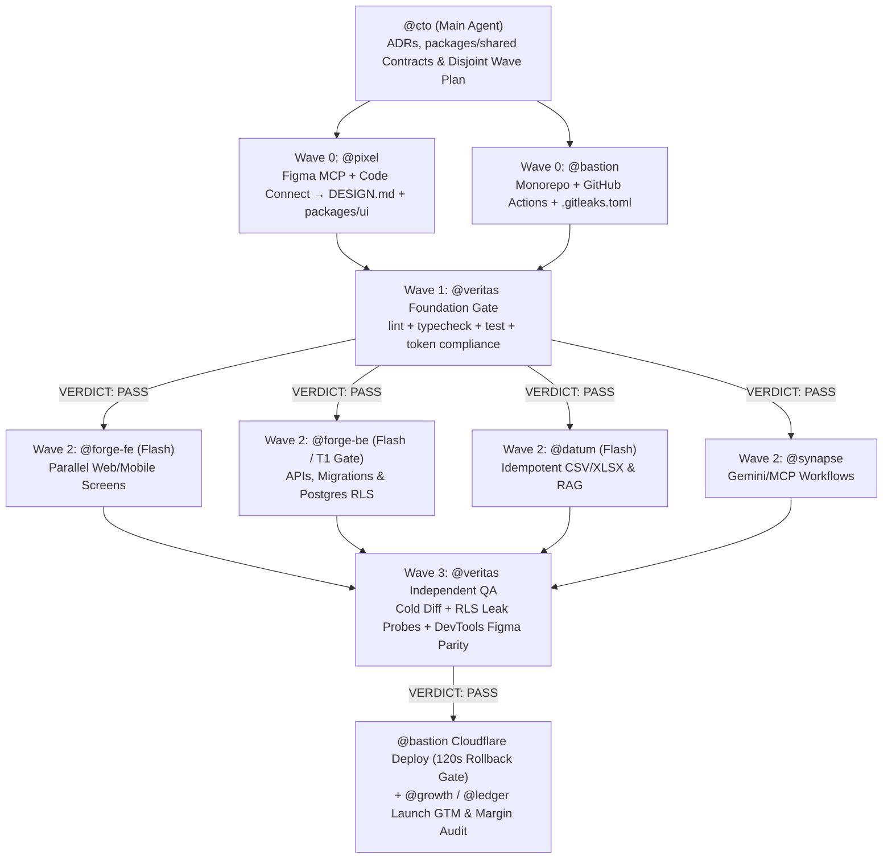

<div align="center">

# GoOnline Agent Skills & Swarm Team

**Production-tested, ultra-low-token AI Agent Skills and 10 Native Multi-Agent Specialists for Digital Strategy, SEO/GEO, UX/UI Figma Systems, and Full-Stack Software Engineering.**

Built and battle-tested in live client delivery by **[GoOnline.ma](https://goonline.ma)** — Performance Digital Marketing & Custom Software Agency *(A [Big M Solutions](https://bigmsolutions.net) Company · Casablanca · Paris · Sheridan, WY)*.

[](https://goonline.ma)
[](#skills-catalog)
[](#swarm-agents-catalog)
[](#why-3-tier-router-skills)
[](./LICENSE)

**Compatible with:** Google Antigravity · Claude Code · Cursor · Hermes Agent · Codex · Windsurf

[Interactive Install](#quick-install) · [Usage Guide](#usage-instructions) · [Skills Catalog](#skills-catalog) · [Swarm Agents Catalog](#swarm-agents-catalog) · [4-Wave Swarm Flow](#how-the-4-wave-swarm-runs) · [Work With GoOnline.ma](#work-with-goonlinema)

</div>

---

## Quick Install

Keep your context window lean by installing **only** the skills and agents your workflow needs. Full agent-executable specification: **[`INSTALL.md`](./INSTALL.md)**.

### Option A — Interactive Multi-Step Install Inside Your AI Harness *(Recommended)*

Paste this single prompt into **Google Antigravity**, **Claude Code**, **Hermes Agent**, **Cursor**, **Codex**, or **Windsurf**:

```text
Read https://raw.githubusercontent.com/goonline-ma/agent-skills/main/INSTALL.md and walk me through installing only the GoOnline skills and agents I need.
```

**What your harness does automatically:**
1. Auto-detects installed environments (`antigravity`, `claude-code`, `hermes` profiles, `.agents/`) via `scripts/install.py --detect --json`.
2. Prompts you with **multi-step native questions** (`ask_question` in Antigravity, `AskUserQuestion` in Claude Code, `clarify` in Hermes) to pick your **target harness(es)**, **scope** (`global` vs. `workspace`), and **role preset or exact individual skills & agents** (displaying per-item token costs).
3. Adapts frontmatter per harness automatically (native Antigravity `commandExecutionPolicy`, Anthropic `.claude/agents/` model mapping, and `<= 60`-char validated descriptions for Hermes) and prints a verified token-footprint receipt.

### Option B — Interactive Terminal Wizard or Selective CLI (`scripts/install.py`)

Prefer an interactive terminal menu—or repeatable CI/team flags? Zero external `pip` packages required (Python 3.9+ stdlib):

```bash
git clone https://github.com/goonline-ma/agent-skills.git
cd agent-skills

# Launch the 4-step interactive terminal wizard
python scripts/install.py

# Or install a preset / exact modules directly across one or multiple harnesses
python scripts/install.py --harness antigravity,claude-code --scope global --preset marketing
python scripts/install.py --harness antigravity --scope workspace --skills bigm-dev-team-architecture --agents cto,pixel,forge-fe,veritas
python scripts/install.py --harness hermes --hermes-profile growth --skills growth-strategy --agents growth,ledger
```

### Option C — Full Antigravity Plugin Bundle (1-Command All-In)

Installs all skills and all 10 swarm agents together as a single toggleable Antigravity plugin:

```bash
git clone https://github.com/goonline-ma/agent-skills.git
agy plugin install ./agent-skills
```

### Option D — Skills CLI (`npx skills`)

```bash
# Interactive skill picker (or add --skill <name> to target one)
npx skills add goonline-ma/agent-skills
npx skills add goonline-ma/agent-skills --skill growth-strategy
npx skills add goonline-ma/agent-skills --skill bigm-dev-team-architecture
```

---

## Why 3-Tier Router Skills?

Most open-source skill packs dump 40–60 granular `SKILL.md` files into your global directory. Because coding agents inject **every installed skill's and subagent's description into every turn**, bloated packs burn **5,000+ tokens per message** before you type a word—evicting critical engineering skills from context and degrading tool selection.

Every skill and agent in **`goonline-ma/agent-skills`** follows a strict **Progressive Disclosure + Deterministic Script** budget:

| Layer | What Loads & When | Token Cost | Why It Matters |
| :--- | :--- | :---: | :--- |
| **Tier 1 — Skill Frontmatter** | Compact YAML `name` + `description` | **~52–54 tokens** *(always)* | **99% lower idle footprint** vs. 50-file skill packs; zero skill eviction. |
| **Native Agent Registry** | Compact 1-line `description` per specialist | **~39–42 tokens** *(always)* | Full 10-agent engineering & growth org stays resident for ~413 tokens total. |
| **Tier 2 — Master Router (`SKILL.md`)** | Pre-flight rules, routing table & chaining recipes | **~1,270–1,885 tokens** *(when triggered)* | Prevents loading Paid Ads or ETL rules when you only asked for a Pitch Deck. |
| **Tier 3 — Playbooks & Scripts** | `references/*.md` + Python/PowerShell CLIs | **0 idle tokens** *(strictly on demand)* | Replaces LLM mental-math guesses and visual hallucinations with exit-code checks. |

---

## Skills Catalog

We continuously publish production playbooks extracted from **500+ delivered digital & software engagements**.

| Skill | Category | Idle Tokens | On-Demand Modules | Deterministic Scripts |
| :--- | :--- | :---: | :--- | :--- |
| **[`growth-strategy`](./skills/growth-strategy)** | Digital Strategy, SEO/GEO, Decks, CRO, ABM & Paid Media | `~52 tok` | **9** playbooks (`references/01..09`) | `growth_calc.py`, `deck_qa.py`, `render_deck_windows.ps1`, `citation_ledger.py` |
| **[`bigm-dev-team-architecture`](./skills/bigm-dev-team-architecture)** | CTO-Led Multi-Agent Swarm OS, Figma UX/UI, RLS & Cloudflare | `~54 tok` | **5** playbooks (`references/01..05`) | `swarm_preflight.py`, `board.py`, `claude_critical_run.py` |

*(Upcoming releases from GoOnline Labs: **E-Commerce CRO & Server-Side CAPI/GA4**, **Cloud ERP / Dolibarr / Perfex Module Engineering**, and **Multilingual FR/EN/AR Localization**.)*

### 1. [`growth-strategy`](./skills/growth-strategy) — Master Digital Strategy & Growth OS

Replaces dozens of overlapping marketing prompts with one surgical router covering full-funnel B2B & B2C growth:

- **[`01-digital-strategy-gtm.md`](./skills/growth-strategy/references/01-digital-strategy-gtm.md)** — Positioning (April Dunford), JTBD/ICP definition, Hormozi Grand Slam Offer engineering, pricing tiers, and 90-day GTM launch plans.
- **[`02-pitch-decks-presentations.md`](./skills/growth-strategy/references/02-pitch-decks-presentations.md)** — Spec-vs-pitch stress-testing, 12-slide narrative arc, 1-message-per-slide layout rules, PowerPoint/PDF export (`render_deck_windows.ps1`), and automated bounding-box overlap & slide contact-sheet inspection (`deck_qa.py`).
- **[`03-seo-geo-search.md`](./skills/growth-strategy/references/03-seo-geo-search.md)** — Unified Google SEO + Generative Engine Optimization (ChatGPT Search, Perplexity, Claude, Google AI Overviews): Bing/IndexNow + SSR gates, 40–60 word citable answer blocks, shortlist entity consensus, JSON-LD, and anti-bloat programmatic SEO.
- **[`04-website-design-cro.md`](./skills/growth-strategy/references/04-website-design-cro.md)** — 5-second clarity test, 10-block high-converting landing page blueprint, Fogg `B=MAP` checkout friction audit, Core Web Vitals (`LCP <= 2.5s`, `INP <= 200ms`, `CLS < 0.1`), and native Arabic `dir="rtl"` logical CSS rules.
- **[`05-outbound-abm-sales.md`](./skills/growth-strategy/references/05-outbound-abm-sales.md)** — Cited 1-page executive prospect dossiers, Clay-style trigger Waterfall (`Hiring` / `Stack` / `Expansion`), `<75`-word cold email & LinkedIn sequences, and shipped-build-to-ABM case study flywheels.
- **[`06-content-copy-social.md`](./skills/growth-strategy/references/06-content-copy-social.md)** — Pillar-to-6× content atomization, Schwartz 5 awareness levels, founder LinkedIn cadence, and ruthless anti-AI-slop prose editing.
- **[`07-paid-media-creative.md`](./skills/growth-strategy/references/07-paid-media-creative.md)** — Google, Meta, TikTok & LinkedIn campaign architecture, `3 Hooks × 3 Formats` creative testing matrices, CAPI/UTM tracking gates, and turnkey 8-part media briefs.
- **[`08-growth-loops-analytics.md`](./skills/growth-strategy/references/08-growth-loops-analytics.md)** — Viral/content/sales growth loops, North Star KPI trees, ICE/RICE backlog scoring (`growth_calc.py score`), onboarding activation, and churn recovery.
- **[`09-bigm-and-compliance.md`](./skills/growth-strategy/references/09-bigm-and-compliance.md)** — Brand governance plus EU **GDPR** and Moroccan **Loi 09-08 (CNDP)**, **Loi 31-08**, and **Loi 69-21** marketing compliance checks.

### 2. [`bigm-dev-team-architecture`](./skills/bigm-dev-team-architecture) — CTO-Led Multi-Agent Engineering Swarm OS

Operating system for running **parallel multi-agent software builds by default** without middle-management relay bottlenecks, git index collisions, or runaway API token burn:

- **[`01-swarm-dag-orchestration.md`](./skills/bigm-dev-team-architecture/references/01-swarm-dag-orchestration.md)** — Star-topology wave planning (unlinking artificial serial screen chains), disjoint file-glob partitioning (`swarm_preflight.py check-overlap`), 3-tier failure recovery, and prompt-caching cost guardrails.
- **[`02-subagent-definitions.md`](./skills/bigm-dev-team-architecture/references/02-subagent-definitions.md)** — Native agent dispatch contracts + fallback `define_subagent` JSON specs.
- **[`03-ux-ui-figma-workflow.md`](./skills/bigm-dev-team-architecture/references/03-ux-ui-figma-workflow.md)** — End-to-end Figma MCP extraction (`get_design_context`, `get_variable_defs`, `get_screenshot`, Code Connect), `DESIGN.md` + `packages/ui` semantic token contracts, 5-state component completeness, WCAG 2.2 AA, `375px`–`1440px`, and Arabic `dir="rtl"` logical CSS.
- **[`04-architecture-rls-security.md`](./skills/bigm-dev-team-architecture/references/04-architecture-rls-security.md)** — Wave 0 ADR & `packages/shared` contracts, database-enforced PostgreSQL `FORCE ROW LEVEL SECURITY` penetration matrix, idempotent financial RPCs, and T1 critical gate (`claude_critical_run.py`).
- **[`05-qa-devops-cloudflare.md`](./skills/bigm-dev-team-architecture/references/05-qa-devops-cloudflare.md)** — Independent 3-round QA + `chrome-devtools-mcp` visual parity, GitHub Projects v2 CLI (`board.py`), secret scanning (`swarm_preflight.py scan-secrets`), and Cloudflare deployment + 120s rollback.

---

## Swarm Agents Catalog

All **10 agents** in [`agents/`](./agents) ship with `mainAgent: true` and `subagent: true`, meaning each can be **launched standalone** (`agy --agent <name>`) OR **orchestrated in parallel** as background subagents (`invoke_subagent`) by `cto`.

| Agent | Role | Default `model` | Idle Tokens | Primary Scope, MCPs & Guardrails |
| :--- | :--- | :---: | :---: | :--- |
| **[`cto`](./agents/cto.md)** | **Hands-On CTO & Swarm Tech Lead** | `inherit` | `~39 tok` | Authors ADRs (`docs/adr/`) & shared contracts (`packages/shared`), validates disjoint file globs via `swarm_preflight.py`, orchestrates parallel waves, gates merges on fresh `gh` checks. |
| **[`pixel`](./agents/pixel.md)** | **Principal UX/UI & Figma Systems Lead** | `inherit` | `~42 tok` | Pulls Figma frames/variables/Code Connect via Figma MCP into `DESIGN.md` & `packages/ui`; enforces 5 UI states, WCAG 2.2 AA, `375px`–`1440px`, LTR/RTL logical CSS & `transform`/`opacity` motion. |
| **[`forge-fe`](./agents/forge-fe.md)** | **Senior Frontend, Web & Mobile Dev** | `flash` | `~42 tok` | Implements Next.js, React, PWA & Android Compose screens strictly inside assigned `owned_globs` using `packages/ui` tokens & `packages/shared` schemas. Zero raw hex or mock data. |
| **[`forge-be`](./agents/forge-be.md)** | **Senior Backend, API & DB Dev** | `flash` | `~42 tok` | Builds APIs, atomic idempotent checkout/inventory RPCs, forward/backward SQL migrations, and PostgreSQL `FORCE ROW LEVEL SECURITY` policies with cross-tenant denial tests. |
| **[`datum`](./agents/datum.md)** | **Data, ETL & RAG Pipeline Engineer** | `flash` | `~40 tok` | Builds idempotent CSV/XLSX/ERP importers with `--dry-run` validation, FR/AR encoding safety, `TEST_` synthetic fixtures, and provenance-backed hybrid RAG indexes. |
| **[`synapse`](./agents/synapse.md)** | **Principal AI & Skill Architect** | `inherit` | `~42 tok` | Builds deterministic Gemini / Agents SDK state machines, structured outputs, MCP integrations, and packages repeatable workflows into 3-tier `SKILL.md` skills. |
| **[`bastion`](./agents/bastion.md)** | **DevSecOps, CI/CD & Cloudflare SRE** | `flash` | `~41 tok` | Bootstraps monorepos, GitHub Actions (`lint`, `typecheck`, `gitleaks`, RLS & `dist/` secret scan), Cloudflare deploys (`cf` CLI / `wrangler`), and 120s auto-rollback. |
| **[`veritas`](./agents/veritas.md)** | **Independent QA & Red-Team Judge** | `inherit` | `~41 tok` | Never grades its own code. Runs cold diff review, SQL RLS leak probes, and live `chrome-devtools-mcp` browser checks (`375px`, `1440px`, `dir="rtl"`) to issue `VERDICT: PASS` or `FAIL`. |
| **[`growth`](./agents/growth.md)** | **VP of Growth & Sales Enablement** | `flash` | `~42 tok` | Executes `growth-strategy` playbooks + `growth_calc.py`, `citation_ledger.py`, and `deck_qa.py` for cited prospect dossiers, SEO/GEO, ABM sequences, and zero-overlap pitch decks. |
| **[`ledger`](./agents/ledger.md)** | **Deal Desk, FinOps & Compliance Lead** | `flash` | `~41 tok` | Runs Python-verified SOW/ROI and AI-token vs. human-hour margin audits, plus EU GDPR and Moroccan Law 09-08 (CNDP), 31-08 & 69-21 compliance checks. |

### Using the Agents in Practice

```bash
# 1. Verify all 10 agents are discovered by Antigravity
agy agents

# 2. Launch the CTO orchestrator interactively to lead a multi-agent build
agy --agent cto

# 3. Launch a specialist directly (e.g., Figma-to-code design system or independent QA audit)
agy --agent pixel
agy --agent veritas -p "Run a 3-round QA, RLS, and secret-scan audit on the current branch"
```

---

## How the 4-Wave Swarm Runs

Instead of chaining agents in a slow game of telephone (`Screen 1 → Screen 2 → Screen 3`), **`cto`** locks contracts and design tokens in **Wave 0**, verifies the build in **Wave 1**, and fans out collision-free parallel specialists in **Wave 2**:



---

## Usage Instructions

Full recipes, harness mappings, and CLI flags live in **[`USAGE.md`](./USAGE.md)**.

### 1. Invoke by Harness

| Harness | Use a Skill | Run a Specialist Agent |
| :--- | :--- | :--- |
| **Google Antigravity** | Automatic by prompt intent (or `use growth-strategy`) | `agy --agent cto` / `agy --agent pixel`, or delegate in chat (`@cto`, `@pixel`, `@veritas`) |
| **Claude Code** | `/growth-strategy` or `/bigm-dev-team-architecture` | `claude --agent cto` or ask Claude to delegate to `pixel`, `forge-fe`, `veritas` |
| **Hermes Agent** | `hermes -p <profile> --skill growth-strategy` | `hermes -p coo` / `hermes -p growth` |
| **Cursor / Codex** | Reference `@growth-strategy` or ask naturally | Reference `@.agents/agents/cto.md` or `@.agents/agents/pixel.md` |

### 2. High-Impact Starter Prompts

- **Run a Multi-Agent Product Build (`@cto` Swarm):**
  > `Use bigm-dev-team-architecture as @cto. Read docs/SCOPE.md, lock Wave 0 ADRs and packages/shared contracts, spawn @pixel for DESIGN.md + packages/ui and @bastion for CI, pass Wave 1 with @veritas, then fan out Wave 2 features in parallel across @forge-fe, @forge-be, and @datum.`
- **Turn a Figma Design into Production Code (`@pixel` → `@forge-fe` → `@veritas`):**
  > `@pixel Extract design tokens, auto-layout specs, and Code Connect mappings from https://www.figma.com/design/<fileKey>/<name>?node-id=12-34 into DESIGN.md and packages/ui, have @forge-fe implement all 5 UI states, and have @veritas audit parity at 375px, 1440px, and RTL.`
- **Launch Digital Strategy, SEO/GEO & Cited Prospect Dossiers (`growth-strategy` + `@growth`):**
  > `Use growth-strategy to audit https://example.com for Google SEO and ChatGPT/Perplexity GEO citability, build our 90-day GTM funnel targets with growth_calc.py, and draft a cited 1-page prospect dossier tracked in citation_ledger.py.`
- **Manage Installed Modules Anytime:**
  ```bash
  python scripts/install.py --list-installed
  python scripts/install.py --uninstall --harness antigravity --scope global --agents datum,synapse
  ```

---

## Work With GoOnline.ma

> **Open-source playbooks and swarm agents give your stack better judgment. When revenue and deadlines are on the line, partner with the engineering and growth agency that built them.**

**[GoOnline.ma](https://goonline.ma)** is a full-stack **Performance Digital Marketing & Custom Software Agency** headquartered in Casablanca, Morocco, operating as part of **[Big M Solutions](https://bigmsolutions.net)** across **Morocco, Europe, Canada, and the United States**.

- **12+ Years** building digital growth engines and mission-critical software *(since 2014)*
- **500+ Delivered Projects** & **100+ Custom Websites, E-Commerce Stores & SaaS Platforms**
- **150+ Group Consultants** across AI engineering, UX/UI, growth marketing, and BPO (`98%` client retention)
- **Certified Platform Partners:** **Google Partner** · **Meta Business Partner** · **TikTok Marketing Partner** · **WordPress Partner**

### What We Build & Scale for Ambitious Brands

| Practice Area | How GoOnline Delivers Measurable ROI | Explore |
| :--- | :--- | :--- |
| **1. High-Converting Websites & E-Commerce** | Custom UX/UI in Figma, mobile-first Next.js / WordPress / Shopify builds, sub-2.5s Core Web Vitals, checkout CRO, and multilingual (`FR` / `EN` / `AR`) experiences. | [Creation Site Web Maroc →](https://goonline.ma/services-creation-site-web-maroc) |
| **2. Technical SEO & AI Search (GEO)** | Semantic & technical SEO, Google Business Profile dominance, topical authority clusters, and Generative Engine Optimization so your brand gets cited and recommended by ChatGPT, Perplexity, and Google AI Overviews. | [Agence SEO & GEO →](https://goonline.ma/services-agence-seo-maroc) |
| **3. Performance Media Buying & CRO** | Full-funnel Google Ads, Meta, TikTok, LinkedIn, and Microsoft campaigns backed by server-side Conversions API (`CAPI`), GA4 attribution, and high-velocity creative testing focused on CPA and ROAS. | [Achat Media & Ads →](https://goonline.ma/services-achat-media) |
| **4. Custom Software, ERP/CRM & AI Agents** | Multi-tenant SaaS platforms, B2B distributor & loyalty portals, Cloud ERP/CRM ecosystems (GoCRM, Atlasbase, Dolibarr, Perfex), and production AI agent swarms shipped on Supabase & Cloudflare. | [goonline.ma →](https://goonline.ma) |
| **5. Social Media, Content & Brand Studio** | Executive LinkedIn positioning, video & UGC production, localized FR/EN/Arabic/Darija storytelling, and investor/enterprise pitch decks. | [goonline.ma →](https://goonline.ma) |
| **6. Managed Cloud, Security & Maintenance** | Cloudflare Zero Trust & edge acceleration, automated backups, security audits, GDPR / CNDP Law 09-08 data protection alignment, and proactive SLA support. | [goonline.ma →](https://goonline.ma) |

### Ready to Grow Traffic, Leads, or Ship Custom Software 3× Faster?

- **Website:** [https://goonline.ma](https://goonline.ma) · Group: [https://bigmsolutions.net](https://bigmsolutions.net)
- **Email:** [contact@goonline.ma](mailto:contact@goonline.ma)
- **Phone / WhatsApp:** `+212 520 991707` *(Casablanca HQ — FR / EN / AR)*

---

## Contributing New Skills & Agents

All contributions to this repository must pass 4 gates before merge:
1. **Token Budget:** Skill `SKILL.md` frontmatter stays `<= 60 tokens`; Agent `agents/*.md` `description` stays `<= 45 tokens`.
2. **Progressive Disclosure:** Keep `SKILL.md` as a concise router (`<120 lines`) and place deep domain procedures inside `references/*.md`.
3. **Strict Plugin Validation:** Run `agy plugin validate . --strict` (`0` errors, `0` warnings).
4. **Zero Leaks:** Run `python skills/bigm-dev-team-architecture/scripts/swarm_preflight.py scan-secrets .` (`0` secrets, `0` `.env` files, `0` hardcoded local user paths).

---

## License

Released under the [MIT License](./LICENSE) © **GoOnline.ma & Big M Solutions**.
